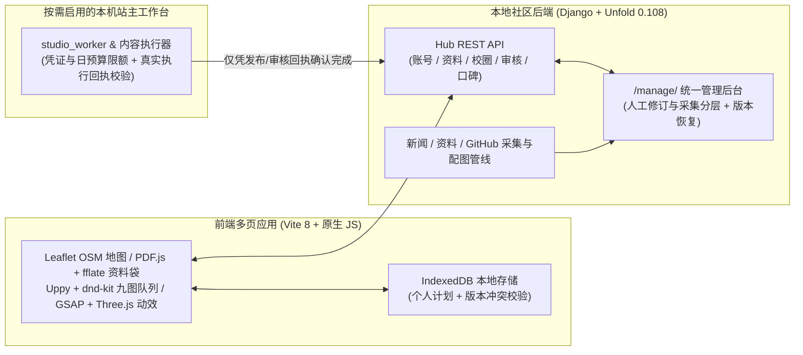

# Luokixi · 中国矿业大学（北京）校园信息、资料与开源创作平台

> 以真实双校区地图为起点，把场馆预约、课程资料检索、校园社区与开源项目发现收束在同一套本地可自托管的原型里。

[](https://luokixi-web.cozy-whale-9871.chatgpt.site)
[](#技术栈与架构)
[](#技术栈与架构)
[](LICENSE)

---

## 在线简易演示

无需安装任何环境，直接打开静态演示体验双校区地图、页面层级与交互动效：

- 🌐 **在线体验入口**：[`https://luokixi-web.cozy-whale-9871.chatgpt.site`](https://luokixi-web.cozy-whale-9871.chatgpt.site)
- 💻 **完整全栈功能**（账号、资料上传审核、九图校圈发帖、Django Unfold 统一后台与站主本地工作室）按下方「本地快速启动」在个人电脑运行。

---

## 设计起点

在学校里，“知道要办什么事”和“知道去哪里办”常常是脱节的：想订场馆得先确认校区与楼宇，再去翻预约链接；想找往年课程经验与公开资料，得在群聊、网盘和帖子间反复跳转，下载后也常常说不清原件来源。

**Luokixi** 围绕中国矿业大学（北京）学院路、沙河两个校区的真实路径设计了六个核心入口，并把**可溯源、防覆盖、断点可恢复**写入了具体功能规则。

---

## 六个核心入口

| 模块 | 主要能力 | 页面入口 |
| :--- | :--- | :--- |
| **首页与校园报** | 附带来源与时效标注的校园新闻、关注动态、基于浏览器合成动画的透视轮播 | `index.html` |
| **双校区校园地图** | 学院路 / 沙河真实 OSM 矢量地图（Leaflet）、地点详情直连官方预约页、个人座位提醒 | `map.html` / `reservations.html` |
| **课程资料库** | 按课程 / 年份 / 类型多维筛选、内置 PDF 预览（PDF.js）、投稿审核、带来源清单的 ZIP 资料袋（fflate） | `materials.html` / `viewer.html` |
| **校圈与课程口碑** | 校区论坛、热议搜索、九图发布与纵深多图滑轨、点赞收藏回复及独立教师/课程口碑 | `circle.html` / `reputation.html` |
| **开源发现广场** | 面向同学的开源项目竖向发现流、原仓库入口、已核对中文导读与公开评论 | `discover.html` / `projects.html` |
| **个人中心与站主工作室** | 账号、个人计划（IndexedDB 本地保存与冲突校验）、贡献可视化与站主后台管理 | `me.html` / `studio.html` |

---

## 技术栈与架构



---

## 重点打磨的工程细节

- **九图上传断点复用队列**：支持连续选择、拖入、粘贴追加（最多 9 张）、拖拽调序与单项删除；上传中途失败时保留页面内待发队列，重试自动复用已成功上传的图片，免去重复选图与排序。
- **按显示帧合并的多图纵深滑轨**：帖子流、详情页与首页多栏目共用横向视差滑轨；通过 `requestAnimationFrame` 合并拖动写入并移除无效回调，复用统一弹簧惯性与吸附参数，解决边界空转与拖动卡顿（复测方法见 [`docs/DEPTH_MOTION_20261010.md`](docs/DEPTH_MOTION_20261010.md)）。
- **人工修订与采集数据严格分层**：引入 Django Unfold 管理后台与页面内联编辑，支持审核、换图和历史版本恢复；手工修改的新闻与项目独立入层，后续自动采集不会覆盖人工修订（见 [`docs/CONTENT_MANAGEMENT_20261009.md`](docs/CONTENT_MANAGEMENT_20261009.md)）。
- **内容任务以真实执行回执为准**：站主端触发的 AI 内容指令必须凭实际发布或审核回执确认完成状态，避免出现“只保存草稿却口头汇报成功”。
- **可核验的资料与配图规范**：优先采用可追溯来源原图与项目 README 原图；资料袋下载自动生成来源清单，缺失资料的栏目展示空状态而不用虚构内容填充。

---

## 本地快速启动

**环境要求**：Node.js `22.12+`、Python `3.12+`（本轮完整验收在 Windows 环境下完成）。

```bash
# 1. 安装前端依赖并构建（只看前端页面可运行 npm run dev）
npm ci
npm run build
```

Windows PowerShell 启动完整本地社区：

```powershell
python -m venv campus/.venv
campus/.venv/Scripts/python -m pip install -r campus/requirements.txt -r campus/hub-requirements.txt
campus/.venv/Scripts/python campus/manage_hub.py migrate
campus/.venv/Scripts/python campus/manage_hub.py hub_import_catalogue
campus/.venv/Scripts/python campus/manage_hub.py hub_import_reputation
campus/.venv/Scripts/python campus/manage_hub.py hub_import_boards
campus/.venv/Scripts/python campus/manage_hub.py createsuperuser
powershell -NoProfile -ExecutionPolicy Bypass -File campus/start.ps1
```

启动后访问 **http://127.0.0.1:17860/**（Linux / macOS 在完成迁移后可分终端运行 `python campus/run_hub.py` 与 `python campus/server.py --port 17860`）。

### 自动化校验与测试

```bash
npm run validate
npm run test:materials
npm run test:client
npm run test:motion
python campus/manage_hub.py test hub
npm run build
```

本机基线累计通过 540 项社区检查（1 项跳过）、73 项 Hub 后端测试、资料袋与图片队列测试以及桌面/移动视口浏览器验收（详录于 `docs/RELEASE_0_3.md` 与 `docs/SOCIAL_MEDIA_20261010.md`）。

---

## 边界声明与许可

- 本项目为学生自发维护的**非官方网站**，所有通知与预约以学校官方入口为准；暂未接入校内单点登录、实时空位查询或自动抢座。
- 公开仓库不含私人试卷、他人上传文件、本机数据库或模型密钥；站主 AI 工作室需手动配置凭证与日预算后才可调用。
- 原创代码采用 [MIT License](LICENSE)；地图数据源自 [Leaflet](https://leafletjs.com/) 与 [OpenStreetMap contributors](https://www.openstreetmap.org/copyright)，其余第三方依赖保留各自原许可。
